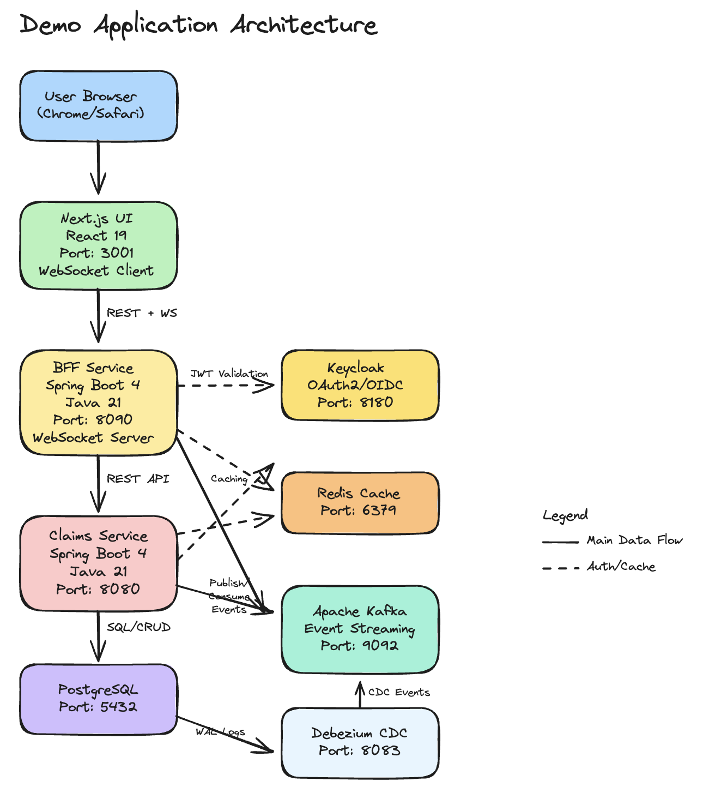

# QA Presentation – Insurance Claims App

How to use this file: go through it top to bottom. Each numbered section is one "slide".
- **Say:** what to tell the audience.
- **Show:** what to open on screen.

The sections follow the review scorecard: strategy, test cases, Playwright, defects, UI, API, contract testing and thought process.

**Suggested timing (about 25 minutes):**

| # | Section | Minutes |
|---|---|---|
| 1 | The app and its architecture | 4 |
| 2 | Test strategy | 4 |
| 3 | Test case design | 3 |
| 4 | Playwright framework | 4 |
| 5 | Live run | 3 |
| 6 | Defects | 4 |
| 7 | Contract testing | 1 |
| 8 | What I would do next | 2 |

---

## 1. The app and its architecture

**Say:** "I tested the Claims app itself, end to end. A claimant raises insurance claims and an admin reviews them. The app has three tiers plus supporting infrastructure."



| Part | Technology | Port | Role |
|---|---|---|---|
| UI | Next.js 16 / React 19 | 3001 | The pages: My Claims, Submit Claim, Admin Claims, Dashboard |
| BFF (Backend for Frontend) | Spring Boot | 8090 | The only API the browser calls: login cookies, CSRF, role checks, WebSocket |
| Claims Service | Spring Boot (hexagonal) | 8080 | Business rules, claim status changes, database |
| Keycloak | OAuth2 / JWT | 8180 | Login and roles (`USER`, `ADMIN`) |
| PostgreSQL | DB (Liquibase migrations) | 5432 | Claims and users |
| Redis | Cache | 6379 | Dashboard stats |
| Kafka (+ optional Debezium CDC) | Events | 9092 | Status-change events → BFF → WebSocket → UI ("Live") |

**Key flows to explain:**
1. **Request:** Browser → BFF (cookie plus CSRF token) → Claims Service (JWT) → Postgres.
2. **Status lifecycle:**
   - `SUBMITTED` → `UNDER_REVIEW` or `REJECTED`
   - `UNDER_REVIEW` → `APPROVED`, `REJECTED` or `SUBMITTED`
   - `APPROVED` or `REJECTED` → `CLOSED`
3. **Real-time:** Claims Service → Kafka → BFF → WebSocket → the claimant's screen updates without a reload.
4. **Security:** the cookies are httpOnly, so page scripts can't read them. Every write needs a CSRF token. Roles are checked in the BFF and again in the Claims Service.

**Business rules the tests check:**
- Location: 5–200 characters
- Description: 10–1000 characters
- Amount: more than 0, at most 1,000,000
- Incident date: not in the future

**Show:** [ARCHITECTURE.md](ARCHITECTURE.md) and the running app at `http://localhost:3001`.

---

## 2. Test strategy → [TEST_STRATEGY.md](TEST_STRATEGY.md)

**Say:** "I ranked the risks first and put the most testing where a failure would hurt most."

| Rank | Risk | Why it's first |
|---|---|---|
| R1 | Authorization: a user sees or changes someone else's claim | Security and privacy |
| R2 | Claim lifecycle: illegal status changes, or the owner doesn't see the decision | Core business rule |
| R3 | Contract drift between the BFF and the Claims Service | A silent break, found only at runtime |
| R4 | Event delivery: a status change is lost or duplicated | Real-time feature |
| R5–R7 | Login and session, dashboard cache, performance | Lower impact |

**What the strategy covers** (point at each section of the document):
- **Test pyramid:** Unit → API → Integration (Testcontainers) → Contract (Pact) → E2E (Playwright). Each check sits at the lowest level that can prove it.
- **Scope:** in-scope and out-of-scope lists.
- **Traceability matrix:** requirement → risk → unit, integration, contract, API and UI test.
- **Test data strategy:** personas, seed claims, a unique run ID in every description, and each test creates its own data.
- **Entry, exit and suspension criteria:** for example, every R1–R4 test passes, no open Critical or High defects, and at least 80% domain coverage.
- **CI/CD plan:**
  - every PR: blocking unit and contract checks;
  - merge to main: security and visibility E2E;
  - nightly: the full suite in both event modes.
- **Defect management:** severity levels and what each defect report must contain.

---

## 3. Test case design → [TEST_CASES.md](TEST_CASES.md)

**Say:** "I designed 10 UI cases and 10 API cases. Each has an ID, preconditions, steps, test data and an expected result. Each case mixes positive, negative, boundary, data-driven and security checks."

| Area | Cases | Positive | Negative | Boundary / data-driven | Security |
|---|---|---|---|---|---|
| UI | 10 | 7 | 5 | 2 | 4 |
| API | 10 | 6 | 6 | 5 | 6 |

**Examples worth showing:**
- **API-CLM-02:** a data table of boundary values, such as a description of 9, 10, 1000 and 1001 characters, and amounts of 0.01, 1,000,000 and 1,000,000.01.
- **API-ADM-02:** the full status-change matrix, showing which changes are allowed and which are refused.
- **API-ADM-03:** attack cases: no token, an edited JWT signature, a role changed to ADMIN without re-signing, and no CSRF token.
- **UI-CLM-02:** a description containing script code is shown as plain text and never runs.

---

## 4. Playwright framework → `code/demo-app-ui/e2e/`

**Say:** "I automated exactly 10 API tests and 10 UI tests against the real Claims app, using a page object model and a clean folder structure."

```
e2e/
├── env.ts               reads e2e/.env (URLs, logins), so nothing is hard-coded
├── commons/             common methods
│   ├── api-session.ts   real login, cookies and CSRF token, like a browser
│   ├── api-client.ts    claim API and admin API calls
│   ├── api-types.ts     request and response shapes
│   └── constants.ts     routes, status codes, statuses, field limits
├── fixtures/            logged-in sessions and pages handed to each test
├── testdata/            claim and login test data
├── utils/               date, string and currency helpers (one file each)
├── pageobject/
│   ├── objects/         locators only (getByRole / getByLabel)
│   └── pages/           page object model: actions and checks per page
└── tests/
    ├── api/claims.api.spec.ts   10 API tests
    └── ui/claims.ui.spec.ts     10 UI tests
```

**Design choices to mention:**
- **Page object model in two layers:** `objects` holds the locators and `pages` holds the behaviour. When the UI changes, only one file changes.
- **Semantic locators:** `getByRole` and `getByLabel`, with no CSS or XPath tied to styling.
- **Fast set-up:** each test creates its own data through the API (fast and reliable), then checks the UI. Tests are independent and safe to run in parallel.
- **Two users in one test:** the admin and the claimant each get their own browser context, so "the admin changes a status and the claimant sees it" is tested for real.
- **Evidence on failure:** traces, screenshots and video, plus an HTML report and JUnit XML.
- **Strict TypeScript:** the code passes `tsc --noEmit`.

**API tests (10)**

| ID | Checks | Test case |
|---|---|---|
| API-01 | Valid claim → 201, status SUBMITTED, reads back unchanged | API-CLM-01/03 |
| API-02 | Description of 9 characters → 400 | API-CLM-02 |
| API-03 | Amount 1,000,000.01 → 400 | API-CLM-02 |
| API-04 | Future date → 400 and no claim saved (**fails: DEF-01**) | API-CLM-02 |
| API-05 | Claimant lists their own claims only | API-VIS-01 |
| API-06 | Claimant on the admin list → 403 | API-VIS-01 |
| API-07 | No login → 401 | API-ADM-03 |
| API-08 | SUBMITTED → UNDER_REVIEW → APPROVED, and the owner sees it | API-ADM-01 |
| API-09 | SUBMITTED → APPROVED is refused and the claim is unchanged | API-ADM-02 |
| API-10 | No CSRF token → 403 and nothing changes | API-ADM-03 |

**UI tests (10)**

| ID | Checks | Test case |
|---|---|---|
| UI-01 | Wrong password is refused | UI-AUTH-01 |
| UI-02 | Login lands on My Claims, and logout works | UI-AUTH-01 |
| UI-03 | Page opened without login → login page, remembering the page | UI-VIS-03 |
| UI-04 | Claim submitted through the wizard is listed with the same values | UI-CLM-01 |
| UI-05 | Location under 5 characters is blocked | UI-CLM-02 |
| UI-06 | Description under 10 characters is blocked | UI-CLM-02 |
| UI-07 | Claimant sees their own claim, not someone else's | UI-VIS-01 |
| UI-08 | Claimant opening the admin page is sent back | UI-VIS-03 |
| UI-09 | Admin sets Under Review, and the claimant sees it | UI-ADM-01 |
| UI-10 | Only legal next statuses are offered | UI-ADM-04 |

---

## 5. Live run

**Show (in a terminal, in `code/demo-app-ui`):**
```bash
npx playwright test                       # all 20 tests (2 workers, installed Chrome)
npx playwright show-report                # HTML report with traces and screenshots
```
**Expected result:** 19 passed, 1 failed (about 1.7 minutes).
**Say:** "The one failure, API-04, is a real bug, so I kept the test strict. A test that turns a bug into a pass hides it."

**Before presenting, have these ready:**
- **The app is running:** `./start-infra.sh`, then `./start-app.sh -d`.
- **The UI page has been opened once:** the UI runs in dev mode, so the first page load is slow.
- **In VS Code:** tick **ui-chromium** under Testing → Playwright → Projects.

---

## 6. Defects → [defects/defects.md](defects/defects.md)

**Say:** "I found 13 defects. I reproduced 7 in the running app and found 6 in code review. Every defect has an ID, steps, expected and actual result, severity and a screenshot. I also list two suspected issues that turned out *not* to be defects."

| ID | Defect | Severity |
|---|---|---|
| DEF-08 | Shared API client swaps login tokens between users' requests | **Critical** |
| DEF-05 | 8 of 10 valid logins sent at the same time get 401 | High |
| DEF-07 | Status changes don't reach the user in real time, though the header says "Live" | High |
| DEF-09 | User endpoints have no admin check, and a user ID can be re-pointed | High |
| DEF-01/02/03 | Errors come back as 500 instead of 400/403/404 | Medium |
| DEF-04 | Amount 10.005 is accepted, then stored as 10.01 | Medium |
| DEF-06 | Admin list has no pagination: 5,630 claims, about 11 s to load | Medium |
| DEF-10 | Token valid for 24 h, cookie only 5 min | Medium |
| DEF-12 | UI Docker image fails on a fresh clone | Medium |
| DEF-11, DEF-13 | UTC date check; wrong field name in the test event | Low |

**Show:** the screenshots for DEF-07 (the "Live" header while the status is stale) and DEF-04 (10.005 becomes 10.01).

---

## 7. Contract testing (honest status)

**Say:** "Contract drift is risk R3 in my strategy, and the plan is Pact, with the BFF as consumer and the Claims Service as provider. The repo already has the groundwork:
- the OpenAPI specs `bff-api.yml` and `claims-api.yml`;
- clients generated from those specs;
- WireMock stubs in `bff-service/mocks`;
- `contract-test` profiles.

I have **not implemented the contract tests yet**. I gave priority to E2E tests and real defects. The first step would be OpenAPI response-schema checks on the 10 API tests, then a Pact consumer test for each BFF → Claims call."

---

## 8. Thought process and next steps

**Say:**
- **How I worked:**
  - I started from risk, not from screens.
  - I wrote the strategy and test cases before any automation.
  - I automated the highest-risk paths: data isolation, the lifecycle and CSRF.
- **I verified before reporting:** every defect was retried against the running app or confirmed in the code. Two suspected issues were dropped because they didn't reproduce.
- **I kept the tests honest:** a known bug fails its test (API-04). A refused illegal transition is checked, and the wrong 500 code is noted as a defect.
- **I fixed what blocked testing:**
  - generated the missing API client so the UI would build;
  - limited runs to 2 workers for the dev-mode UI;
  - used the installed Chrome because the Playwright browser download failed.

**Next steps:**
1. Contract tests: schema validation, then Pact (section 7).
2. Automate the remaining designed cases: the full transition matrix, token-tampering attacks, and the real-time event test in both event modes.
3. Add tests for each defect fix, then run them in CI as the strategy's pipeline describes.
4. Cross-browser smoke tests (Firefox is already set up for CI) and a k6 performance baseline for the admin list (DEF-06).

---

## Quick reference

| Item | Where |
|---|---|
| Architecture | [ARCHITECTURE.md](ARCHITECTURE.md) |
| Test strategy | [TEST_STRATEGY.md](TEST_STRATEGY.md) |
| Test cases | [TEST_CASES.md](TEST_CASES.md) |
| Defects and screenshots | [defects/defects.md](defects/defects.md) |
| Playwright code | `code/demo-app-ui/e2e/` |
| Playwright config | `code/demo-app-ui/playwright.config.ts` |
| Run all tests | `npx playwright test` (in `code/demo-app-ui`) |
| Test logins | `claimant@demo.com`, `admin@demo.com` (passwords in `e2e/.env`) |
