# Defects – Claims App

**Tested on:** 19 Nov 2026, local Docker stack. The UI runs at `http://localhost:3001` and the BFF at `http://localhost:8090`.
**Test accounts:** `claimant@demo.com` (claimant) and `admin@demo.com` (admin).

**Severity scale**

| Severity | Meaning |
|---|---|
| Critical | Security or data exposure between users |
| High | A main feature is broken or unsafe |
| Medium | Wrong behaviour that has a workaround, or wrong error codes |
| Low | Minor, an edge case, or test-only |

The **How found** column means:
- **Reproduced:** seen in the running app. The screenshot shows the real request and response, or the real screen.
- **Code review:** found in the source code. The screenshot shows the exact code lines.

## Summary

| ID | Title | Severity | How found |
|---|---|---|---|
| [DEF-01](#def-01) | Future incident date returns 500 instead of 400 | Medium | Reproduced |
| [DEF-02](#def-02) | Illegal status change returns 500 instead of 400 | Medium | Reproduced |
| [DEF-03](#def-03) | Another user's claim or an unknown claim returns 500 instead of 403/404 | Medium | Reproduced |
| [DEF-04](#def-04) | Claim amount with 3 decimals is accepted and then silently changed | Medium | Reproduced |
| [DEF-05](#def-05) | Valid logins at the same time are refused with 401 | High | Reproduced |
| [DEF-06](#def-06) | Admin claims list has no pagination (5,630 claims in one response) | Medium | Reproduced |
| [DEF-07](#def-07) | Claim status changes don't reach users in real time | High | Reproduced |
| [DEF-08](#def-08) | Shared API client swaps bearer tokens between concurrent requests | Critical | Code review |
| [DEF-09](#def-09) | User endpoints have no admin check; a user ID can be re-pointed | High | Code review |
| [DEF-10](#def-10) | Access token valid for 24 hours, cookie only 5 minutes | Medium | Code review |
| [DEF-11](#def-11) | Future-date check uses the server's UTC date | Low | Code review |
| [DEF-12](#def-12) | UI Docker image fails on a fresh clone (API client never generated) | Medium | Code review |
| [DEF-13](#def-13) | Test CDC event uses field `id`, but the BFF reads `claim_id` | Low | Code review |

---

## DEF-01 – Future incident date returns 500 instead of 400

| Field | Value |
|---|---|
| Severity | Medium |
| Area | BFF API – `POST /api/claims` |
| Automated test | API-04 in `e2e/tests/api/claims.api.spec.ts` (fails because of this defect) |

**Steps**
1. Log in as `claimant@demo.com`.
2. Send `POST /api/claims` with `incidentDate` set to 7 days from today. All other fields are valid.

**Expected:** HTTP 400 with "Incident date cannot be in the future".
**Actual:** HTTP 500 Internal Server Error, with no message.

**Cause:** the Claims Service returns 400 correctly. The BFF then wraps every downstream error in an `IllegalStateException`, which becomes a 500. See [ClaimsServiceAdapter.java:150-151](../code/bff-service/src/main/java/com/example/demo/adapter/out/claimsservice/ClaimsServiceAdapter.java#L150-L151).
The UI blocks future dates itself, so the problem shows only through the API.

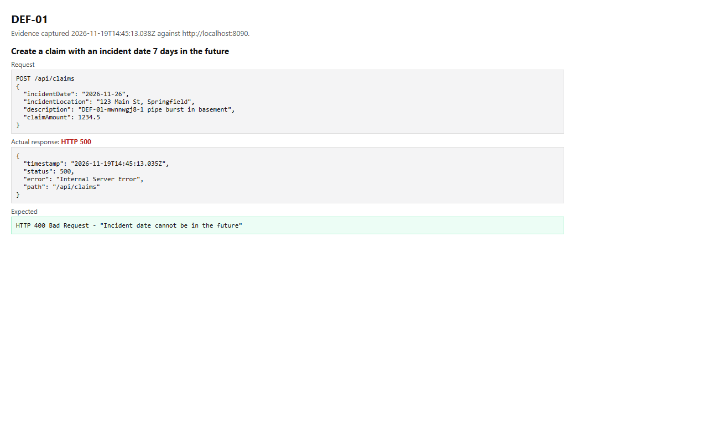

---

## DEF-02 – Illegal status change returns 500 instead of 400

| Field | Value |
|---|---|
| Severity | Medium |
| Area | Admin API – `PATCH /api/admin/claims/{claimId}/status` |
| Automated test | API-09 (checks that the change is refused, and notes this defect) |

**Steps**
1. As the claimant, create a claim. Its status is SUBMITTED.
2. As the admin, send `PATCH /api/admin/claims/{claimId}/status` with `{ "status": "APPROVED" }`.

**Expected:** HTTP 400 "Invalid status transition", as documented in `bff-api.yml`. Only UNDER_REVIEW and REJECTED are allowed after SUBMITTED.
**Actual:** HTTP 500. The claim correctly stays SUBMITTED, so only the response code is wrong.

**Cause:** the Claims Service has no exception handler for `InvalidStatusTransitionException` ([Claim.java:121-123](../code/claims-service/src/main/java/com/example/demo/domain/claim/Claim.java#L121-L123)), so it returns 500, and the BFF passes the 500 on.

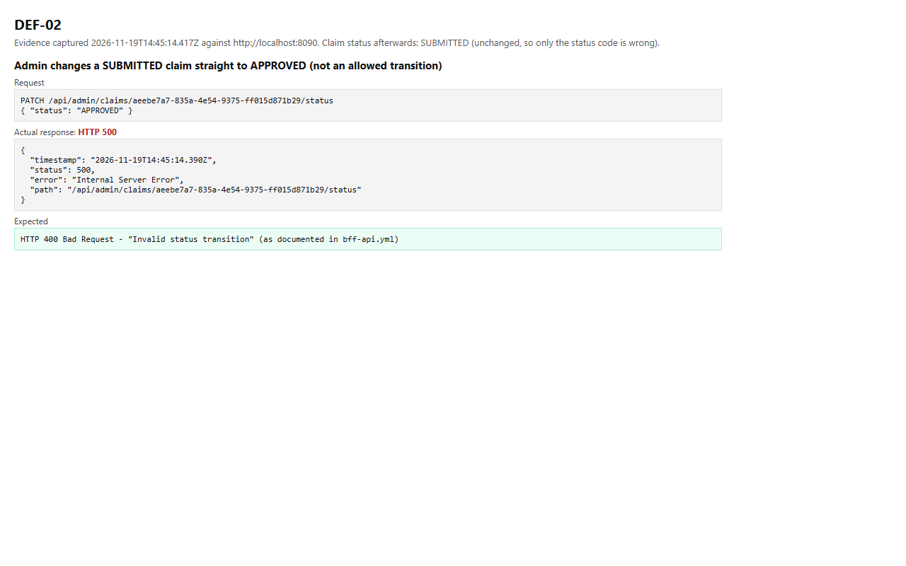

---

## DEF-03 – Another user's claim or an unknown claim returns 500 instead of 403/404

| Field | Value |
|---|---|
| Severity | Medium |
| Area | BFF API – `GET /api/claims/{claimId}` |

**Steps**
1. As the admin, create a claim. From the claimant's point of view, this is someone else's claim.
2. As the claimant, send `GET /api/claims/{that claimId}`.
3. As the claimant, send `GET /api/claims/00000000-0000-4000-8000-000000000000`, an ID that doesn't exist.

**Expected:** step 2 returns **403** "claim belongs to different user", and step 3 returns **404** "Claim not found", as documented in `bff-api.yml`.
**Actual:** both return **500**. No data leaks, but a client can't tell "forbidden" from "not found" from "server crashed".

**Cause:** the BFF recognises 403 and 404 but re-throws them as `IllegalStateException`. See [ClaimsServiceAdapter.java:177-181](../code/bff-service/src/main/java/com/example/demo/adapter/out/claimsservice/ClaimsServiceAdapter.java#L177-L181).

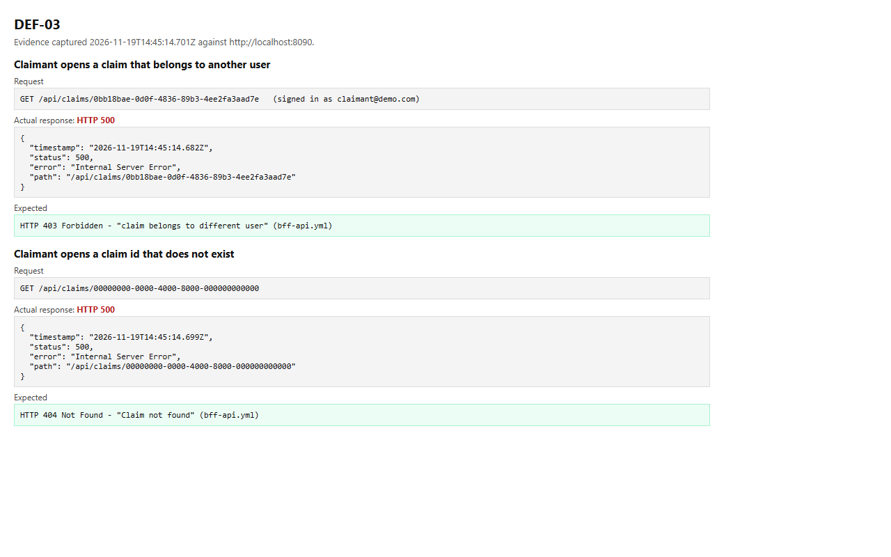

---

## DEF-04 – Claim amount with 3 decimals is accepted and then silently changed

| Field | Value |
|---|---|
| Severity | Medium |
| Area | Claims API and database – `claimAmount` |

**Steps**
1. As the claimant, send `POST /api/claims` with `claimAmount: 10.005`.
2. Read the claim back with `GET /api/claims/{claimId}`.

**Expected:** HTTP 400, because money may have at most 2 decimals. At the very least, the stored amount must equal the amount submitted.
**Actual:**
- The create returns **201** and says `claimAmount: 10.005`.
- Reading the claim back shows **10.01**.

The claimant was told one amount, and a different amount was stored.

**Cause:**
- Validation only checks `minimum: 0.01`. There is no rule for the number of decimals.
- The database column is `DECIMAL(12,2)`, so the value is rounded silently when it is saved ([002-create-claims-table.yaml:37-38](../code/claims-service/src/main/resources/db/changelog/changes/002-create-claims-table.yaml)).
- The UI also allows 3 decimals (`step="0.01"` only).

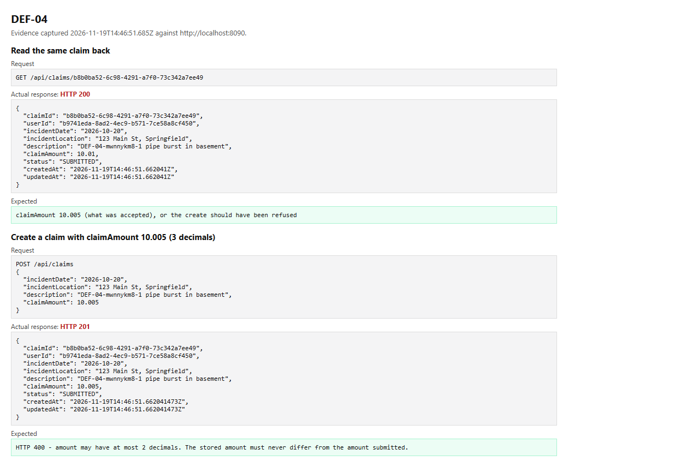

---

## DEF-05 – Valid logins at the same time are refused with 401

| Field | Value |
|---|---|
| Severity | High |
| Area | BFF – `POST /api/auth/login` |

**Steps**
1. Send 10 `POST /api/auth/login` requests at the same moment with **correct** credentials: 5 for the claimant and 5 for the admin.

**Expected:** all 10 return HTTP 200.
**Actual:** only 2 of 10 succeed. The other 8 return **401 "Invalid email or password"**, even though the password is correct.

**Impact:** at busy times, real users are told their password is wrong. The automated tests needed a retry around login to work around this.
**Cause:** not confirmed. The likely area is shared state in the BFF login path (see DEF-08 for a similar pattern).

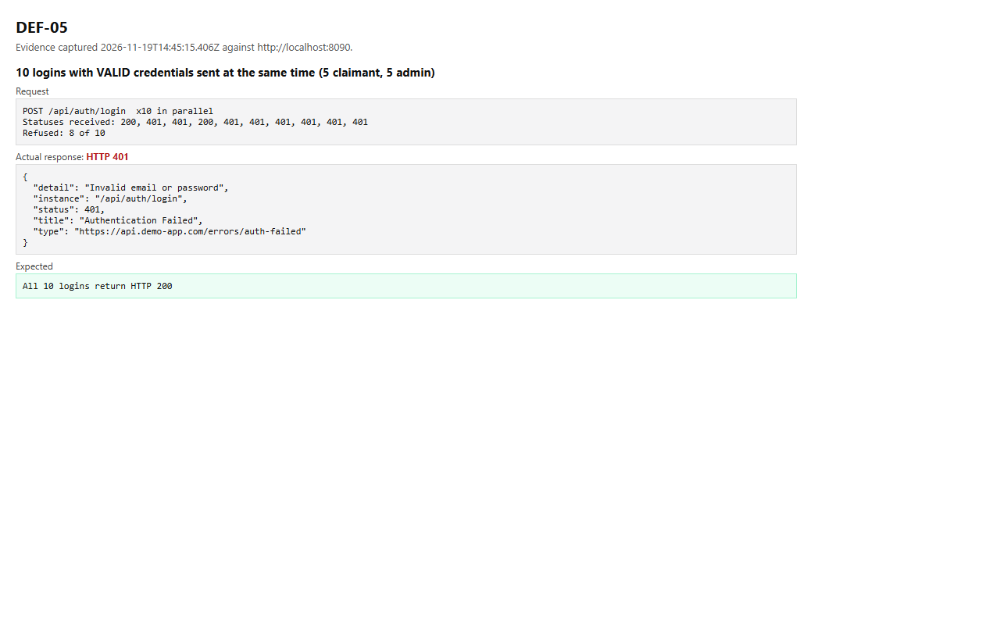

---

## DEF-06 – Admin claims list has no pagination

| Field | Value |
|---|---|
| Severity | Medium |
| Area | Admin API `GET /api/admin/claims` and the admin "Claims Management" page |

**Steps**
1. As the admin, send `GET /api/admin/claims`.
2. Open the **Claims** page in the UI as the admin.

**Expected:** a paginated list (for example 20–50 claims per page) with page controls.
**Actual:**
- **API:** all **5,630 claims** come back in one 2.14 MB response. The endpoint has no page or size parameter.
- **UI:** the page took **about 11 seconds** to render every row, and it has no page controls.

The list will keep growing.

**Cause:** `ListAllClaimsUseCase` calls `claimRepository.findAll()`. `AdminClaimsController.java:151` also looks up the user once per claim, which is the N+1 query problem.

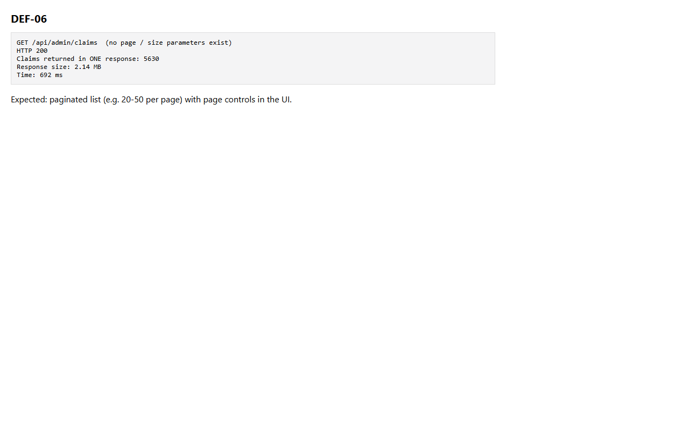
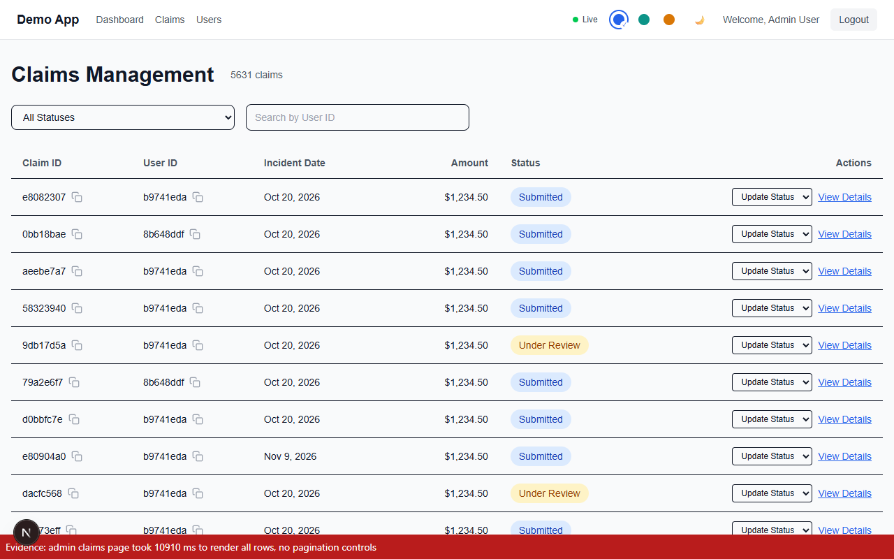

---

## DEF-07 – Claim status changes don't reach users in real time

| Field | Value |
|---|---|
| Severity | High |
| Area | Real-time events: Claims Service → Kafka → BFF → UI |

**Steps**
1. Start the app the normal way (`./start-infra.sh`, then `./start-app.sh`).
2. Log in as the claimant and open **My Claims**. The header shows a green **Live** indicator.
3. As the admin, change one of the claimant's claims from Submitted to **Under Review**.
4. Wait 15 seconds without reloading the claimant's page.

**Expected:** the claimant's page updates to "Under Review" within a few seconds.
**Actual:** the page still shows **Submitted** while the header still says **Live**. The new status appears only after a manual reload.

**Cause:**
- `docker-compose.apps.yml` sets `APP_EVENTS_CDC_ENABLED: "true"`, but the README says the default is `false`.
- With the flag on, the Claims Service stops publishing events directly and relies on Debezium. Debezium is not part of the normal startup, and the `demo-debezium` container had exited, so no events are sent at all.

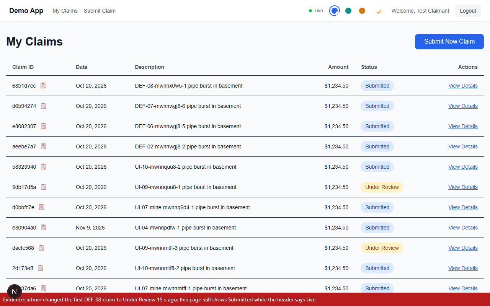

---

## DEF-08 – Shared API client swaps bearer tokens between concurrent requests

| Field | Value |
|---|---|
| Severity | Critical |
| Area | BFF – `AdminController`, `ClaimsServiceAdapter` |
| How found | Code review (a race condition, so it can't be shown with one request) |

**Steps to reproduce**
1. Send admin and claimant requests to the BFF at the same moment, for example in a load test.
2. Check, in the Claims Service logs or with a debugger, which token each downstream call carries.

**Expected:** each downstream call carries the token of the user who made that request.
**Actual (from the code):**
- `AdminController` is a singleton that holds **one** `ApiClient`.
- On every request, it calls `apiClient.setBearerToken(...)` with either the current user's token or the service-account token.
- Concurrent requests overwrite each other's token, so a request can go out with **another user's or the service account's identity**.
- The same pattern is in `ClaimsServiceAdapter.java:215-224`.

Files: [AdminController.java:36](../code/bff-service/src/main/java/com/example/demo/adapter/in/web/AdminController.java#L36), [:150](../code/bff-service/src/main/java/com/example/demo/adapter/in/web/AdminController.java#L150), [:157](../code/bff-service/src/main/java/com/example/demo/adapter/in/web/AdminController.java#L157)

---

## DEF-09 – User endpoints have no admin check; a user ID can be re-pointed

| Field | Value |
|---|---|
| Severity | High |
| Area | Claims Service – `POST /api/users` and `GET /api/users/{id}` |
| How found | Code review |

**Steps to reproduce**
1. Get a valid token for a normal (non-admin) user.
2. Call `GET /api/users/{any user id}` on the Claims Service.
3. Call `POST /api/users` with an **existing** user's email and a new `userId`.

**Expected:** both calls are refused with 403, because only admins and the BFF service account may manage users.
**Actual (from the code):**
- `listAllUsers` is guarded by `@PreAuthorize("hasRole('ADMIN')")`. **`createUser` and `getUser` are not**, so any logged-in user can read any user.
- If the email already exists with a different ID, the code **changes that user's ID** to the one in the request (`updateUserId`, line 67). That gives control of another user's record and claims.

File: [UserController.java:40-70, 96-98](../code/claims-service/src/main/java/com/example/demo/adapter/in/web/UserController.java#L40-L70)

---

## DEF-10 – Access token valid for 24 hours, cookie only 5 minutes

| Field | Value |
|---|---|
| Severity | Medium |
| Area | Keycloak realm configuration and BFF cookies |
| How found | Code review |

**Steps to reproduce**
1. Log in and copy the `access_token` cookie value.
2. Wait more than 5 minutes. The browser drops the cookie.
3. Call the API with the copied token in an `Authorization: Bearer` header.

**Expected:** the token lifetime matches the cookie (about 5 minutes), so a leaked token expires quickly.
**Actual (from the config):**
- Keycloak `accessTokenLifespan` is **86,400 s (24 h)**.
- The BFF's `access_token` cookie lasts **5 minutes**.
- A copied or leaked token stays valid for 24 hours, even after the session idle timeout (30 min).

Files: [demo-app-realm.json:11-13](../docker/compose/keycloak/demo-app-realm.json), [AuthController.java:33-34](../code/bff-service/src/main/java/com/example/demo/adapter/in/web/AuthController.java#L33-L34)

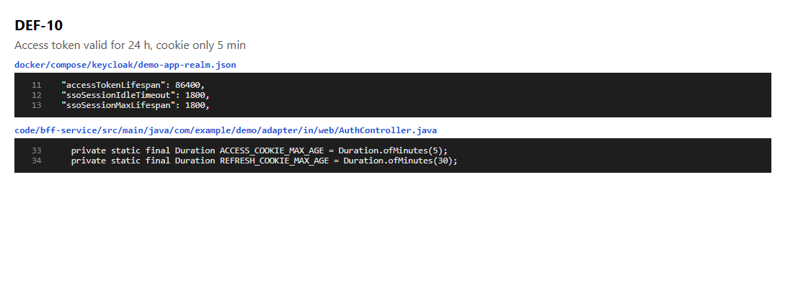

---

## DEF-11 – Future-date check uses the server's UTC date

| Field | Value |
|---|---|
| Severity | Low |
| Area | Claims Service validation and the UI wizard step 1 |
| How found | Code review |

**Steps to reproduce**
1. Set the computer's time zone to India (UTC+5:30).
2. Between 00:00 and 05:30 local time, submit a claim with **today's local date** as the incident date.

**Expected:** accepted. The incident happened today, local time.
**Actual (from the code):**
- The server compares the date with `LocalDate.now()` in the container, which runs on UTC with no time zone set. There it is still yesterday, so "today" is rejected as a future date (and returned as 500, see DEF-01).
- Users west of UTC can submit "tomorrow".
- The UI uses `new Date().toISOString()`, which is also the UTC date.

File: [Claim.java:81-83](../code/claims-service/src/main/java/com/example/demo/domain/claim/Claim.java#L81-L83)

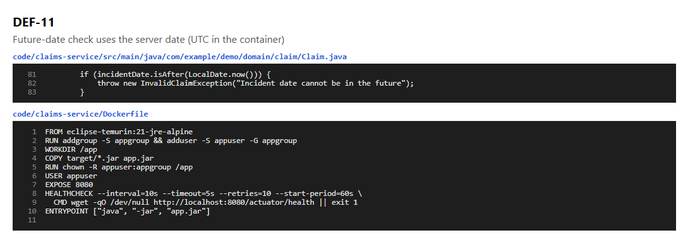

---

## DEF-12 – UI Docker image fails on a fresh clone

| Field | Value |
|---|---|
| Severity | Medium |
| Area | `code/demo-app-ui/Dockerfile` (setup) |
| How found | Code review, plus the build error seen during this test session |

**Steps to reproduce**
1. Clone the repo fresh. `src/lib/api/generated/` is in `.gitignore`, so it doesn't exist.
2. Run `./start-app.sh` and open `http://localhost:3001`.

**Expected:** the login page loads.
**Actual:** the build fails with **"Module not found: Can't resolve './generated'"**. The Dockerfile runs `npm ci` and `next dev` but never `npm run generate:api`. It works only if someone has already generated the client on the host.
**Workaround:** run `npm run generate:api` in `code/demo-app-ui`, then rebuild the `ui` container.

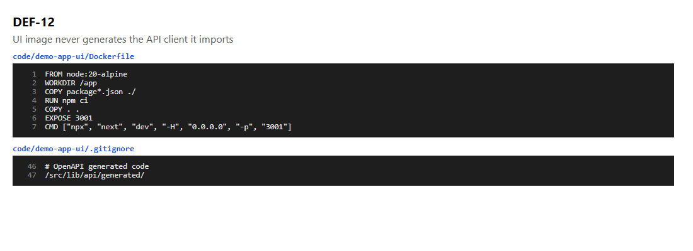

---

## DEF-13 – Test CDC event uses field `id`, but the BFF reads `claim_id`

| Field | Value |
|---|---|
| Severity | Low (the endpoint exists only under the `test` profile) |
| Area | Claims Service `POST /api/test/trigger-event` → BFF Kafka consumer |
| How found | Code review |

**Steps to reproduce**
1. Run the Claims Service with the `test` profile.
2. Call `POST /api/test/trigger-event` with a claim ID and a new status.

**Expected:** the BFF receives the event with the claim ID and forwards it to the claim's owner.
**Actual (from the code):**
- The test payload puts the ID in `after.id`.
- The real CDC column, which the BFF reads, is `after.claim_id`.
- So the BFF gets an **empty claim ID** (and no `before` or `user_id`), and the event goes to admins only. Tests that use this endpoint don't test the real flow.

Files: [TestEventController.java:62-72](../code/claims-service/src/main/java/com/example/demo/adapter/in/web/TestEventController.java#L62-L72), [ClaimEventKafkaConsumer.java:118](../code/bff-service/src/main/java/com/example/demo/adapter/in/messaging/ClaimEventKafkaConsumer.java#L118)

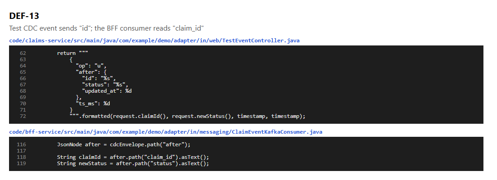

---

## Checked and not a defect

| Suspected issue | Result |
|---|---|
| Amount `0.001` stored as `0.00` | **Not a defect.** It is rejected with 400 "must be greater than or equal to 0.01". The real gap is 3-decimal amounts above 0.01, which is DEF-04. |
| Admin dashboard stats stay stale after a claim is created | **Not reproduced.** The stats updated straight away (`cacheHit: false`). The code has a 5-minute cache with no clearing on writes (`DashboardController.java:24`), so it may appear under other conditions. Retest when the cache is hit. |
