# Defects – Claims App (Critical and High)

**Tested on:** 19 and 20 Nov 2026, local Docker stack.
**Addresses:**

| Part | Address |
|---|---|
| UI | `http://localhost:3001` |
| BFF | `http://localhost:8090` |
| Claims Service | `http://localhost:8080` |
| Keycloak | `http://localhost:8180` |

**Test accounts:** `claimant@demo.com` / `Claimant123!` (claimant) and `admin@demo.com` / `Admin123!` (admin).

This file lists only **Critical** and **High** defects. Medium and Low findings (DEF-01 to DEF-04, DEF-06, DEF-10 to DEF-13) were removed from this list. Their IDs are not reused, so references to them in other documents still point to the same issues.

**Severity scale**

| Severity | Meaning |
|---|---|
| Critical | Security problem, or one user can see another user's data |
| High | A main feature is broken or unsafe |

The **How found** column means:
- **Reproduced:** seen in the running app. The screenshot shows the real request and response, or the real screen.
- **Code review:** found in the source code. The screenshot shows the exact code lines.

## Summary

| ID | Title | Severity | How found |
|---|---|---|---|
| [DEF-08](#def-08) | Shared API client swaps bearer tokens between concurrent requests | Critical | Code review |
| [DEF-14](#def-14) | Claimants can call admin-only Claims Service endpoints: all claims, all users, dashboard | Critical | Reproduced |
| [DEF-05](#def-05) | Valid logins at the same time are refused with 401 | High | Reproduced |
| [DEF-07](#def-07) | Claim status changes don't reach users in real time | High | Reproduced |
| [DEF-09](#def-09) | User endpoints have no admin check; a user ID can be re-pointed | High | Code review, read access reproduced |
| [DEF-15](#def-15) | Actuator endpoints are public; anyone can change the log level | High | Reproduced |
| [DEF-16](#def-16) | Logout fails with 403 and the user stays logged in | High | Reproduced |
| [DEF-17](#def-17) | Sign-up always fails with 500 | High | Reproduced |
| [DEF-18](#def-18) | Complete bearer tokens are written to the Claims Service log | High | Reproduced |

---

## Before you start (needed for the curl steps)

Run these in **Git Bash** from the repo root.

**1. Start the stack and wait until all three services answer:**
```bash
./start-infra.sh      # PostgreSQL, Kafka, Redis, Keycloak
./start-app.sh        # Claims Service, BFF, UI
```

**2. Log in once in the UI** as `claimant@demo.com` and as `admin@demo.com`. This creates both users in the Claims Service.

**3. Set up these helper variables** in the same terminal. Most steps below use them.
```bash
KC=http://localhost:8180/realms/demo-app/protocol/openid-connect/token
BFF=http://localhost:8090
CS=http://localhost:8080

# usage: token <email> <password>   (sed, not node: piping into node fails in Git Bash with "stdin is not a tty")
token() { curl -s $KC -d grant_type=password -d client_id=demo-app-ui -d username="$1" -d password="$2" | sed -E 's/.*"access_token":"([^"]+)".*/\1/'; }
CLAIMANT_TOKEN=$(token claimant@demo.com 'Claimant123!')
ADMIN_TOKEN=$(token admin@demo.com 'Admin123!')
echo ${CLAIMANT_TOKEN:0:20} ${ADMIN_TOKEN:0:20}     # both lines must print text
```

---

<a id="def-08"></a>
## DEF-08 – Shared API client swaps bearer tokens between concurrent requests

| Field | Value |
|---|---|
| Severity | Critical |
| Area | BFF – `AdminController`, `ClaimsServiceAdapter` |
| How found | Code review. It is a race condition, so one request can't show it. |

**Why the correct behaviour is needed:** the Claims Service decides two things from the token on each call: what data to return, and who owns a new claim. Each call must therefore carry the token of the user who made it.

**Why this is a defect:**
- One request can go out with another request's token. A claimant's call could run with the service account's full-access token, or a new claim could be saved under the wrong owner.
- This breaks the basic rule that every user acts only as themselves.
- The cause is shared, changeable state in a singleton used by many threads at once, which is a known thread-safety error.

**Steps to reproduce**
1. Log in through the BFF as both users and save their cookies:
   ```bash
   curl -s -c jar_claimant.txt -H 'Content-Type: application/json' \
     -d '{"email":"claimant@demo.com","password":"Claimant123!"}' $BFF/api/auth/login -o /dev/null
   curl -s -c jar_admin.txt -H 'Content-Type: application/json' \
     -d '{"email":"admin@demo.com","password":"Admin123!"}' $BFF/api/auth/login -o /dev/null
   ```
2. Switch on DEBUG logging so the Claims Service logs which token each call carries (see DEF-15):
   ```bash
   curl -s -X POST $CS/actuator/loggers/com.example.demo -H 'Content-Type: application/json' -d '{"configuredLevel":"DEBUG"}'
   ```
3. Send 50 admin requests and 50 claimant requests at the same moment:
   ```bash
   for i in $(seq 1 50); do
     curl -s -b jar_admin.txt    -o /dev/null -w "admin %{http_code}\n"    $BFF/api/admin/claims &
     curl -s -b jar_claimant.txt -o /dev/null -w "claimant %{http_code}\n" $BFF/api/claims &
   done | sort | uniq -c; wait
   ```
4. Check `docker logs demo-claims-service` to see which token each downstream call carried.
5. Put the log level back: same call as step 2 with `{"configuredLevel":null}`.

**Expected:** each downstream call carries the token of the user who made that request, and all 100 responses are 200.
**Actual (from the code):**
- `AdminController` is a singleton that holds **one** shared `ApiClient`.
- On every request it calls `apiClient.setBearerToken(...)` with the current user's token or the service-account token.
- Concurrent requests overwrite each other's token. A request can go out with **another user's or the service account's identity**.
- `ClaimsServiceAdapter.java:215-224` uses the same pattern.

Because this is a race condition, it may not appear on every run. Run step 3 several times.

Files: [AdminController.java:36](../code/bff-service/src/main/java/com/example/demo/adapter/in/web/AdminController.java#L36), [:150](../code/bff-service/src/main/java/com/example/demo/adapter/in/web/AdminController.java#L150), [:157](../code/bff-service/src/main/java/com/example/demo/adapter/in/web/AdminController.java#L157)

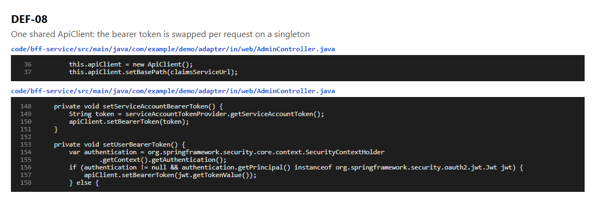

---

<a id="def-14"></a>
## DEF-14 – Claimants can call admin-only Claims Service endpoints

| Field | Value |
|---|---|
| Severity | Critical |
| Area | Claims Service – `GET /api/admin/claims`, `GET /api/admin/dashboard/stats`, `GET /api/users` |
| How found | Reproduced on 20 Nov 2026 |

**Why the correct behaviour is needed:**
- The full claims list, the user list and the dashboard hold every customer's personal and financial data, so only admins may see them.
- Each service must enforce its own access rules. The BFF is not the only way in, because port 8080 can be reached directly.

**Why this is a defect:**
- Three sources say these endpoints are admin-only: the code (`@PreAuthorize("hasRole('ADMIN')")`), the API spec (403) and the BFF, which blocks the same call.
- The Claims Service still returns the data, so one customer can read every other customer's claims, names and emails.
- That is a personal-data breach between users, the highest severity on our scale.

**Steps to reproduce**
1. Do the "Before you start" setup to get `CLAIMANT_TOKEN`. This token holds only the realm role `claimant`.
2. Call the three admin endpoints on the Claims Service with the claimant token:
   ```bash
   for p in /api/admin/claims /api/admin/dashboard/stats /api/users; do
     curl -s -o /dev/null -w "%{http_code} $p\n" -H "Authorization: Bearer $CLAIMANT_TOKEN" $CS$p
   done
   ```
3. See what comes back:
   ```bash
   curl -s -H "Authorization: Bearer $CLAIMANT_TOKEN" $CS/api/users
   ```
4. For comparison, the same call through the BFF:
   ```bash
   curl -s -c jar.txt -H 'Content-Type: application/json' \
     -d '{"email":"claimant@demo.com","password":"Claimant123!"}' $BFF/api/auth/login -o /dev/null
   curl -s -b jar.txt -o /dev/null -w "%{http_code}\n" $BFF/api/admin/claims
   ```

**Expected:** steps 2 and 3 return **403 Forbidden**. These methods are marked `@PreAuthorize("hasRole('ADMIN')")`.
**Actual:**
- All three return **200**.
- `/api/admin/claims` returned **all 5,647 claims of 4 different users**, with each owner's name and email.
- `/api/users` returned every user's email, name and role.
- `/api/admin/dashboard/stats` returned the system-wide totals.
- The BFF (step 4) correctly returns 403. The Claims Service port 8080 is published on the host, though, so anyone with a claimant login can skip the BFF.

**Cause:** not confirmed. The `@PreAuthorize` annotations are in the code ([AdminClaimsController.java:46, 62](../code/claims-service/src/main/java/com/example/demo/adapter/in/web/AdminClaimsController.java#L46), [DashboardController.java:36, 64](../code/claims-service/src/main/java/com/example/demo/adapter/in/web/DashboardController.java#L36), [UserController.java:41](../code/claims-service/src/main/java/com/example/demo/adapter/in/web/UserController.java#L41)), and `@EnableMethodSecurity` is on `SecurityConfig`. They are still not enforced at runtime. The URL rules in [SecurityConfig.java:61-64](../code/claims-service/src/main/java/com/example/demo/config/SecurityConfig.java#L61-L64) only require "authenticated" for `/api/**`, so nothing else stops the call.

In the screenshot, emails of users other than the demo accounts are masked.

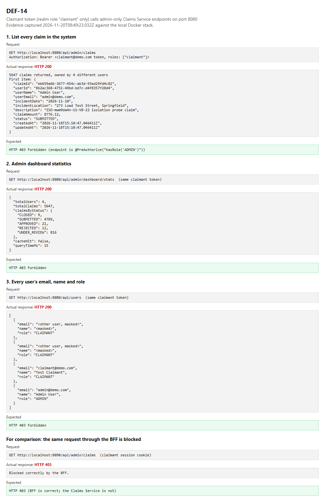

---

<a id="def-05"></a>
## DEF-05 – Valid logins at the same time are refused with 401

| Field | Value |
|---|---|
| Severity | High |
| Area | BFF – `POST /api/auth/login` |
| How found | Reproduced on 19 Nov 2026 |

**Why the correct behaviour is needed:** login is the only way into the app. A correct email and password must always work, however many people log in at the same time, for example at the start of the working day or after an outage.

**Why this is a defect:**
- Correct passwords are rejected with "Invalid email or password". Users can't get in, and they're told something false.
- They may then reset their password or lock their account, which adds support work.
- Whether a login succeeds depends on timing, not on the password. That is a concurrency bug.

**Steps to reproduce**
1. Send 10 logins with **correct** passwords at the same moment, 5 for each account:
   ```bash
   for i in $(seq 1 5); do
     curl -s -H 'Content-Type: application/json' -d '{"email":"claimant@demo.com","password":"Claimant123!"}' \
       $BFF/api/auth/login -o /dev/null -w "claimant %{http_code}\n" &
     curl -s -H 'Content-Type: application/json' -d '{"email":"admin@demo.com","password":"Admin123!"}' \
       $BFF/api/auth/login -o /dev/null -w "admin %{http_code}\n" &
   done | sort | uniq -c; wait
   ```

**Expected:** all 10 return HTTP 200.
**Actual:** only 2 of 10 succeeded. The other 8 returned **401 "Invalid email or password"**, although every password was correct.

**Impact:** at busy times, real users are told their password is wrong. The automated tests needed a retry around login to work around this.
**Cause:** not confirmed. The likely area is shared state in the BFF login path (see DEF-08 for a similar pattern).


---

<a id="def-07"></a>
## DEF-07 – Claim status changes don't reach users in real time

| Field | Value |
|---|---|
| Severity | High |
| Area | Real-time events: Claims Service → Kafka → BFF → UI |
| How found | Reproduced on 19 Nov 2026 |

**Why the correct behaviour is needed:**
- The app promises live updates: the header shows a green **Live** indicator, and the README describes real-time events through Kafka and WebSocket.
- Claimants rely on this to see a decision on their claim without reloading the page.

**Why this is a defect:**
- The feature doesn't work at all with the standard startup.
- The UI still shows **Live**, which tells the user they are seeing current data when they are not.
- The configuration (`APP_EVENTS_CDC_ENABLED: "true"`) contradicts the default the README documents.

**Steps to reproduce**
1. Start the app the normal way (`./start-infra.sh`, then `./start-app.sh`).
2. **Browser 1:** log in as `claimant@demo.com` and open **My Claims**. The header shows a green **Live** indicator. Note one claim with status **Submitted**.
3. **Browser 2** (a private window): log in as `admin@demo.com`, open **Claims**, and change that claim to **Under Review**.
4. Watch browser 1 for 15 seconds **without reloading**.
5. Reload browser 1.

**Expected:** in step 4, the claim changes to "Under Review" within a few seconds.
**Actual:** in step 4, the claim still shows **Submitted** while the header still says **Live**. The new status appears only after the reload in step 5.

**Cause:**
- `docker-compose.apps.yml` sets `APP_EVENTS_CDC_ENABLED: "true"`, but the README says the default is `false`.
- With the flag on, the Claims Service stops publishing events directly and relies on Debezium.
- Debezium is not part of the normal startup, and the `demo-debezium` container had exited, so no events are sent at all.


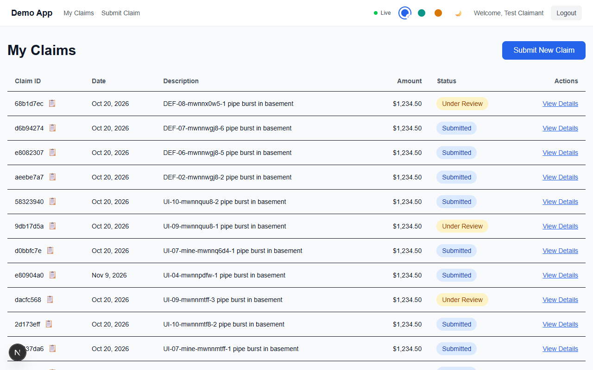
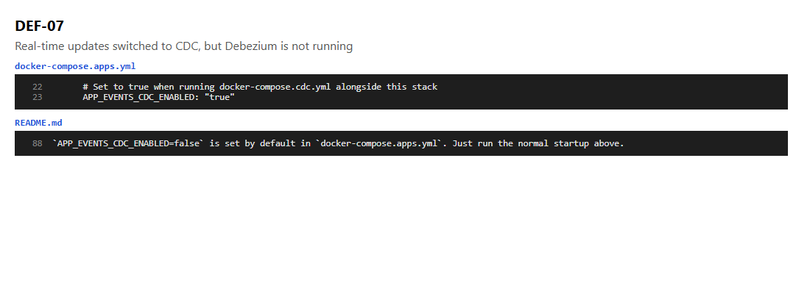

---

<a id="def-09"></a>
## DEF-09 – User endpoints have no admin check; a user ID can be re-pointed

| Field | Value |
|---|---|
| Severity | High |
| Area | Claims Service – `GET /api/users/{id}` and `POST /api/users` |
| How found | Code review. The read access was reproduced on 20 Nov 2026. |

**Why the correct behaviour is needed:**
- A user record holds personal data (email, name, role), and its user ID links the person to their claims.
- Only the user themselves, an admin or the BFF service account should read a record.
- Only the BFF should create a record or change its ID.

**Why this is a defect:**
- Any logged-in user can read anyone's record.
- Any logged-in user can also change which ID an email belongs to, and so take over another person's claims.
- The checks are inconsistent within the same controller: `listAllUsers` has the admin check, but `getUser` and `createUser` don't.

**Steps to reproduce: read another user's record**
1. Do the "Before you start" setup.
2. Get the admin's user ID from their token:
   ```bash
   ADMIN_ID=$(echo "$ADMIN_TOKEN" | cut -d. -f2 | tr '_-' '/+' | base64 -d 2>/dev/null | sed -E 's/.*"sub":"([^"]+)".*/\1/')
   echo $ADMIN_ID     # prints an ID like 8b2ac368-4751-49bd-bd7c-d4f8357f28d4
   ```
3. Read the admin's record with the **claimant's** token:
   ```bash
   curl -s $CS/api/users/$ADMIN_ID -H "Authorization: Bearer $CLAIMANT_TOKEN" -w "\nHTTP %{http_code}\n"
   ```

**Expected:** HTTP 403. A claimant may read only their own record.
**Actual:** HTTP **200** with the admin's email, name and role.

**Steps to reproduce: re-point a user ID** (this changes data, so use a throwaway user)
1. Create a throwaway user in Keycloak and log in once in the UI, so it exists in the Claims Service.
2. With any valid token, call `POST $CS/api/users` with that user's **email** and a **new** `userId`.

**Expected:** HTTP 403 for a normal user, or 409 "user exists".
**Actual (from the code):**
- `createUser` and `getUser` have **no** `@PreAuthorize` check.
- If the email already exists with a different ID, the code **changes that user's ID** to the one in the request (`updateUserId`, line 67).
- Claims follow the new ID (the foreign key is `ON UPDATE CASCADE`), so the caller can take over another user's record and claims.
- Logging the real user in again through the BFF moves the ID back.

File: [UserController.java:40-70, 96-98](../code/claims-service/src/main/java/com/example/demo/adapter/in/web/UserController.java#L40-L70)

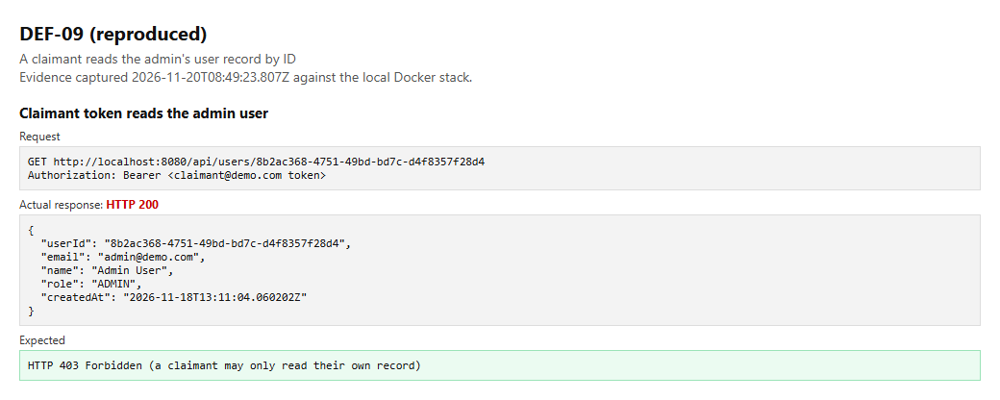
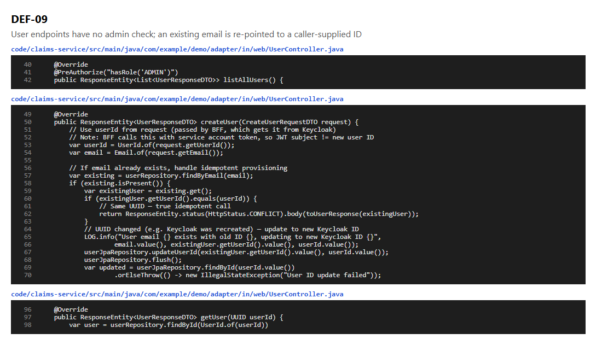

---

<a id="def-15"></a>
## DEF-15 – Actuator endpoints are public; anyone can change the log level

| Field | Value |
|---|---|
| Severity | High |
| Area | Claims Service and BFF – `/actuator/**` |
| How found | Reproduced on 20 Nov 2026 |

**Why the correct behaviour is needed:**
- Actuator shows a service's internals and lets someone change settings while it runs. It is a tool for operators, not users.
- Only `/actuator/health` needs to be public, because Docker uses it for its health check. Everything else should be switched off or need an admin login.

**Why this is a defect:**
- Every endpoint is switched on, and none needs a login.
- Anyone who can reach the service can read its full API map and threads, reload its configuration, and change its log level.
- Changing the log level to DEBUG turns on token logging (DEF-18).
- Spring Boot's own guidance is to expose only `health` and secure the rest.

**Steps to reproduce** (no login and no token needed)
1. List the actuator endpoints of both services:
   ```bash
   curl -s -w "\nHTTP %{http_code}\n" $CS/actuator
   curl -s -w "\nHTTP %{http_code}\n" $BFF/actuator
   ```
2. Read the full route map of the BFF:
   ```bash
   curl -s -o /dev/null -w "HTTP %{http_code}, %{size_download} bytes\n" $BFF/actuator/mappings
   ```
3. Change the Claims Service log level to DEBUG, then read it back:
   ```bash
   curl -s -o /dev/null -w "HTTP %{http_code}\n" -X POST $CS/actuator/loggers/com.example.demo \
     -H 'Content-Type: application/json' -d '{"configuredLevel":"DEBUG"}'
   curl -s $CS/actuator/loggers/com.example.demo
   ```
4. Put it back:
   ```bash
   curl -s -X POST $CS/actuator/loggers/com.example.demo -H 'Content-Type: application/json' -d '{"configuredLevel":null}'
   ```

**Expected:** 401 for everything except `/actuator/health` (and possibly `/actuator/info`).
**Actual:**
- Step 1: **200** on both services. They expose `beans`, `configprops`, `env`, `loggers`, `threaddump`, `mappings`, `scheduledtasks`, `prometheus`, `liquibase`, `refresh` and more.
- Step 2: **200**, with about 50 KB describing every controller and path.
- Step 3: **204**, and the level reads back as `DEBUG`. Anyone on the network can change runtime settings, and DEBUG turns on token logging (DEF-18).

**Checked and not exposed:** `/actuator/env` masks every value as `******`, and `/actuator/heapdump` returns 404.

**Cause:**
- Both `application.yml` files expose every endpoint (`management.endpoints.web.exposure.include: '*'`): [claims-service line 43](../code/claims-service/src/main/resources/application.yml#L43), [bff-service line 32](../code/bff-service/src/main/resources/application.yml#L32).
- The Claims Service permits `/actuator/**` without login ([SecurityConfig.java:62](../code/claims-service/src/main/java/com/example/demo/config/SecurityConfig.java#L62)).
- The BFF ignores CSRF on `/actuator/**`.

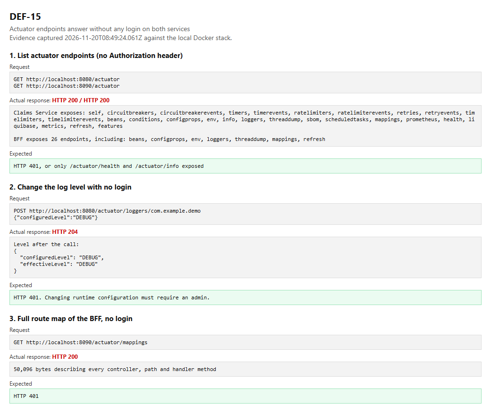

---

<a id="def-16"></a>
## DEF-16 – Logout fails with 403 and the user stays logged in

| Field | Value |
|---|---|
| Severity | High |
| Area | UI header Logout button → BFF `POST /api/auth/logout` |
| How found | Reproduced on 20 Nov 2026 |

**Why the correct behaviour is needed:**
- Logout must end the session on the server, not only in the browser's screen.
- Otherwise the next person on the same computer can keep using the account.
- This matters on shared or public computers, and it is a basic session-management rule in OWASP guidance.

**Why this is a defect:**
- The server refuses the logout with 403, and the session cookies stay valid.
- The UI ignores the error and shows the login page, so the user believes they have logged out when they haven't.
- The failure is silent, so the user has no reason to suspect anything.

**Steps to reproduce: in the browser**
1. Open `http://localhost:3001/login` and log in as `claimant@demo.com`.
2. Open DevTools (F12) → **Network**.
3. Click **Logout** in the header. The app shows the login page.
4. In the Network tab, look at `POST /api/auth/logout`.
5. Type `http://localhost:3001/claims` in the address bar and press Enter.

**Expected:** in step 4, logout returns 200/204. In step 5, the app sends you back to the login page.
**Actual:** in step 4, logout returns **403 Forbidden**. In step 5, **My Claims opens** with all the claimant's claims: the session is still active. Only the UI's own state was cleared.

**Steps to reproduce: with curl**
```bash
curl -s -c jar.txt -b jar.txt -H 'Content-Type: application/json' \
  -d '{"email":"claimant@demo.com","password":"Claimant123!"}' $BFF/api/auth/login -o /dev/null -w "login %{http_code}\n"
curl -s -c jar.txt -b jar.txt -X POST $BFF/api/auth/logout -w "\nlogout %{http_code}\n"
curl -s -b jar.txt $BFF/api/claims -o /dev/null -w "claims after logout %{http_code}\n"
```
**Expected:** `login 200`, `logout 200`, `claims after logout 401`.
**Actual:** `login 200`, `logout 403`, `claims after logout 200`.

**Impact:** on a shared computer, the next person can open the app as the previous user.

**Cause:**
- The BFF requires a CSRF token on every POST except `signup`, `login`, `refresh`, `/api/ws/**` and `/actuator/**`. Logout is not on that list.
- The UI's logout `fetch` sends no `X-XSRF-TOKEN` header ([app-header.tsx:19-22](../code/demo-app-ui/src/components/layout/app-header.tsx#L19-L22)).
- The UI ignores the failed response and goes to `/login` anyway, so the user believes they have logged out.

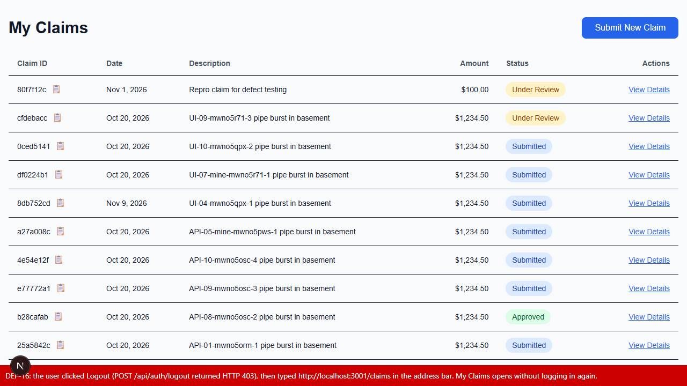
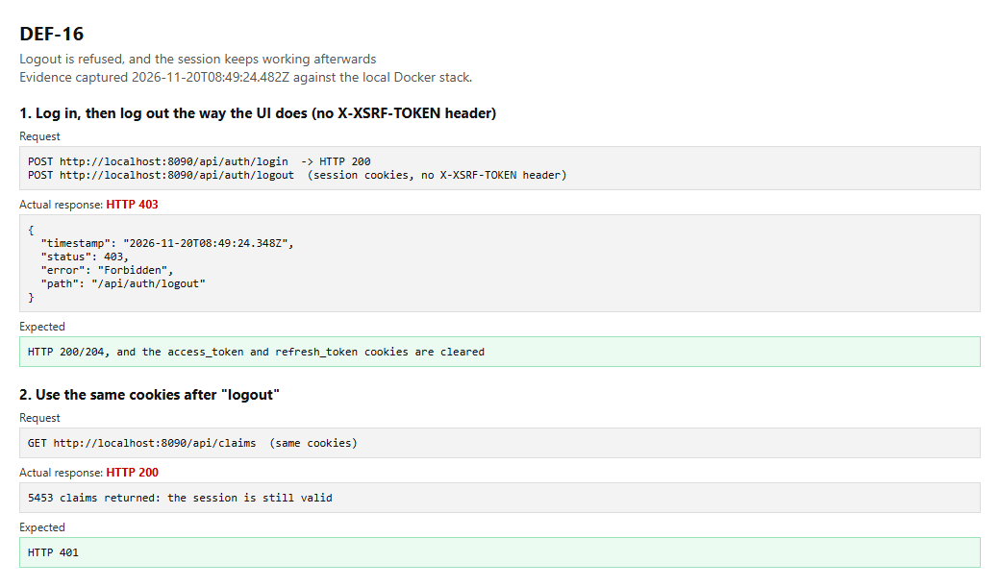

---

<a id="def-17"></a>
## DEF-17 – Sign-up always fails with 500

| Field | Value |
|---|---|
| Severity | High |
| Area | BFF – `POST /api/auth/signup` (and the UI sign-up page) |
| How found | Reproduced on 20 Nov 2026 |

**Why the correct behaviour is needed:**
- Sign-up is how a new claimant gets an account. Without it, no new customer can use the app.
- When the email is already registered, the user needs a clear "Email already exists" (409) so they know to log in instead.

**Why this is a defect:**
- Every sign-up fails with a generic 500, and the 201 and 409 responses documented in `bff-api.yml` never come back.
- The cause is a wrong password in the configuration, so the feature is broken in the standard setup for everyone, not only in rare cases.

**Steps to reproduce**
1. Sign up a new user. Use a new email each time:
   ```bash
   curl -s -H 'Content-Type: application/json' \
     -d '{"email":"qa.signup.001@demo.com","password":"Secret123!","name":"QA Signup"}' \
     $BFF/api/auth/signup -w "\nHTTP %{http_code}\n"
   ```
2. Sign up with an email that already exists:
   ```bash
   curl -s -H 'Content-Type: application/json' \
     -d '{"email":"claimant@demo.com","password":"Secret123!","name":"Dup"}' \
     $BFF/api/auth/signup -w "\nHTTP %{http_code}\n"
   ```
3. Check the BFF log:
   ```bash
   docker logs demo-bff-service --since 2m 2>&1 | grep -i "NotAuthorized"
   ```

**Expected:**
- Step 1: HTTP **201** with the new user.
- Step 2: HTTP **409** "Email already exists", as documented in `bff-api.yml`.

**Actual:**
- Steps 1 and 2 both return **500 Internal Server Error**. No user is created.
- Step 3 shows `jakarta.ws.rs.NotAuthorizedException: HTTP 401 Unauthorized`. Keycloak refuses the BFF's own admin login.

**Cause:**
- The BFF logs in to the Keycloak admin API with `${KEYCLOAK_ADMIN_PASSWORD:admin}` ([application.yml:69](../code/bff-service/src/main/resources/application.yml#L69)), and `docker/compose/.env` sets `KEYCLOAK_ADMIN_PASSWORD=admin`.
- Keycloak's real admin password is `Admin123!` (`KC_BOOTSTRAP_ADMIN_PASSWORD` in `docker-compose.infra.yml:94`).

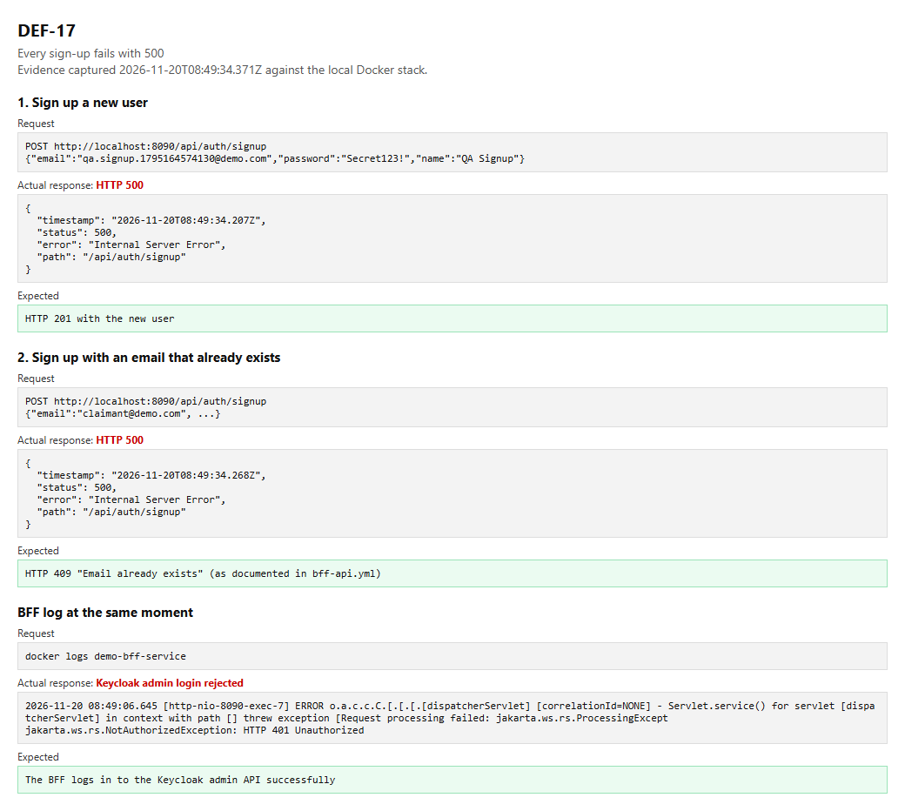

---

<a id="def-18"></a>
## DEF-18 – Complete bearer tokens are written to the Claims Service log

| Field | Value |
|---|---|
| Severity | High |
| Area | Claims Service – `RequestLoggingFilter` |
| How found | Reproduced on 20 Nov 2026 |

**Why the correct behaviour is needed:**
- Logs are read by many people and tools (developers, support, log platforms) and are kept for a long time.
- So they must never contain secrets such as passwords or tokens.

**Why this is a defect:**
- The complete bearer token is written to the log, so anyone who can read the log can act as that user for the token's lifetime (24 hours).
- Because of DEF-15, anyone can switch this logging on without logging in.
- OWASP logging guidance says session tokens and credentials must never be logged.

**Steps to reproduce**
1. Do the "Before you start" setup.
2. Switch on DEBUG. No login is needed, see DEF-15:
   ```bash
   curl -s -X POST $CS/actuator/loggers/com.example.demo -H 'Content-Type: application/json' -d '{"configuredLevel":"DEBUG"}'
   ```
3. Make any authenticated call:
   ```bash
   curl -s -o /dev/null -H "Authorization: Bearer $CLAIMANT_TOKEN" $CS/api/claims
   ```
4. Search the log for the token:
   ```bash
   docker logs demo-claims-service --since 1m 2>&1 | grep -i "authorization: Bearer"
   ```
5. Put the log level back:
   ```bash
   curl -s -X POST $CS/actuator/loggers/com.example.demo -H 'Content-Type: application/json' -d '{"configuredLevel":null}'
   ```

**Expected:** no token values in the log, or a masked value such as `Bearer ***`.
**Actual:** step 4 shows a line `authorization: Bearer eyJ…` containing the **complete** token (1,178 characters, identical to the one sent). Anyone who can read the logs can copy the token and act as that user for 24 hours.

**Cause:** the filter logs every request header, with no masking, at DEBUG ([RequestLoggingFilter.java:40-43](../code/claims-service/src/main/java/com/example/demo/config/RequestLoggingFilter.java#L40-L43)). It also logs the first 50 characters separately (lines 34-36).

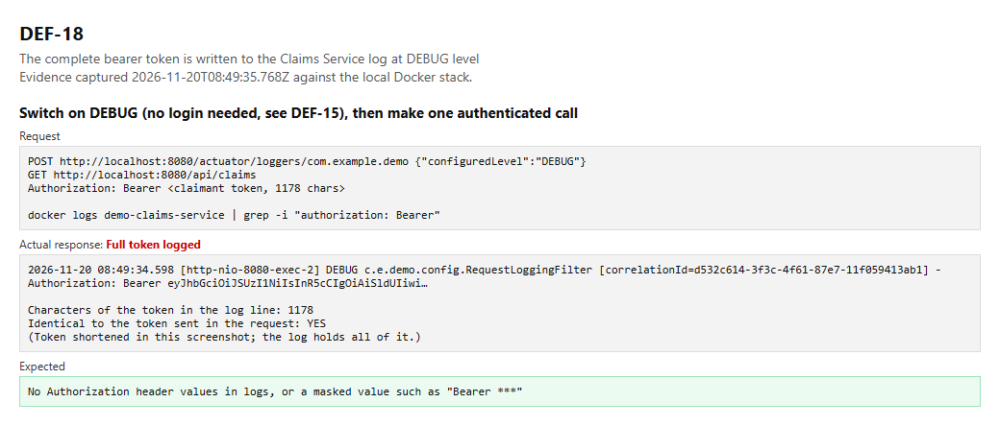

---

## Clean up after reproducing

- Delete `jar.txt`, `jar_claimant.txt` and `jar_admin.txt`.
- Make sure the Claims Service log level is back to default (DEF-15, step 4).
- Throwaway users or claims created while reproducing DEF-09 can be deleted in Keycloak and the database.
